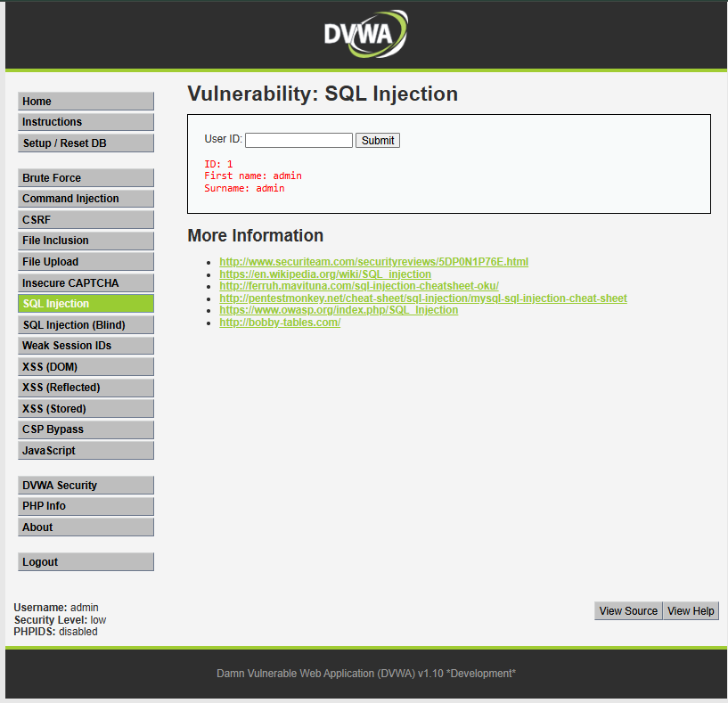
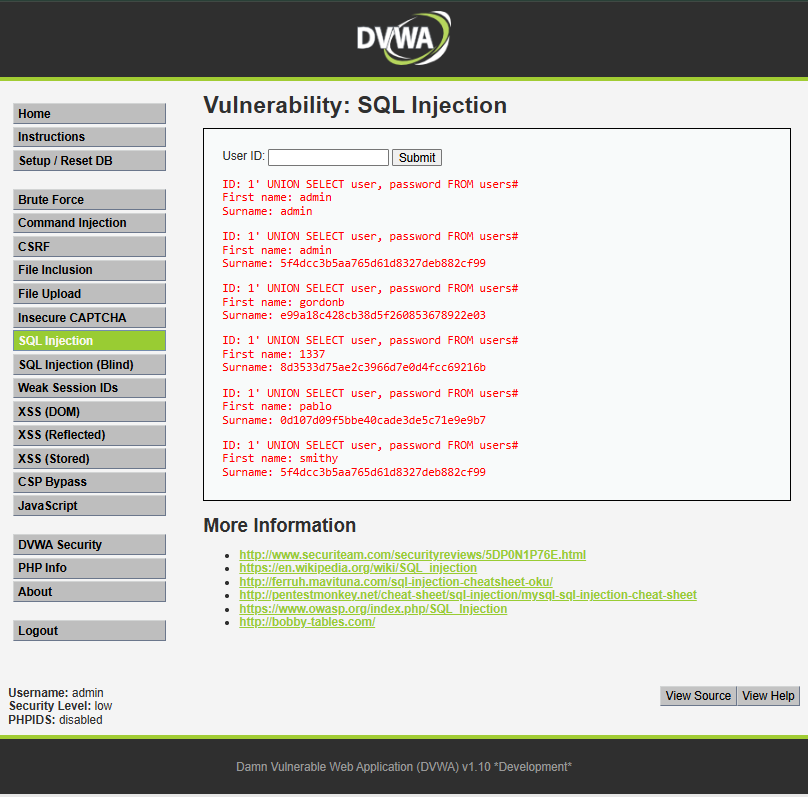

# Web Application Vulnerability Assessment: SQL Injection Analysis

**Author:** Timothy Wilson Marthen  
**Focus Area:** Application Security & Risk Management (GRC)  
**Target Environment:** Damn Vulnerable Web Application (DVWA — Local Lab)  
**Classification:** OWASP Top 10 (A03:2021 - Injection) | **Severity:** Critical (CVSS v3.1: 9.8)

---

## 1. Executive Summary
A vulnerability assessment was conducted on the user input module of a local DVWA instance to evaluate database injection resilience. Testing identified a **Critical SQL Injection** vulnerability in the `id` parameter that allows an unauthenticated or low-privileged attacker to bypass query logic and extract the entire `users` table, including usernames and password hashes. Immediate backend remediation using parameterized queries (PDO prepared statements) is required to prevent unauthorized data exposure and regulatory non-compliance.

## 2. Scope & Methodology
- **Target:** DVWA SQL Injection module (Security Level: Low).
- **Environment:** Local Docker container (`vulnerables/web-dvwa`).
- **Methodology:** Manual black-box input testing followed by white-box source code review, aligned with the **OWASP Web Security Testing Guide (WSTG v4.2)**.

## 3. Technical Findings & Proof of Concept (PoC)

### Finding 01: Unsanitized User Input Leading to SQL Injection
- **CWE Reference:** CWE-89 (Improper Neutralization of Special Elements used in an SQL Command)
- **Description:** The `id` GET parameter is concatenated directly into the backend SQL query string without type validation or parameterization, allowing user-supplied input to alter query execution logic.

#### A. Baseline Behavior
Submitting a valid numeric ID (`1`) returns a single matching user record as intended.



#### B. Query Logic Bypass
Injecting `' OR '1'='1` forces the `WHERE` clause to evaluate as true for every row, dumping all user records stored in the table.


#### C. Credential Extraction (Database Enumeration)
Using a `UNION SELECT` payload, an attacker can query the `users` table directly and extract stored credentials:

```sql
1' UNION SELECT user, password FROM users#
```



## 4. Root Cause & Risk Impact Analysis (GRC Perspective)

### Root Cause (Code Review)
Inspection of the backend PHP handler (`vulnerabilities/sqli/source/low.php`) confirms that `$id` is interpolated directly into the `SELECT` statement via string concatenation:


### Business & Compliance Impact (CIA Triad)
- **Confidentiality (High Impact):** Full exposure of user records and password hashes. Under Indonesian jurisdiction, unauthorized disclosure of personal data violates **Indonesia Personal Data Protection Law (UU PDP No. 27/2022)**, exposing the organization to administrative sanctions and reputational damage.
- **Integrity (High Impact):** Depending on the database account privileges and DBMS configuration, an attacker could alter, corrupt, or delete application records.

## 5. Remediation & Security Controls

### Technical Fix (Parameterized Queries)
Replace raw string concatenation with **PHP PDO Prepared Statements** so user input is bound strictly as data rather than executable SQL syntax:

```php
<?php
$stmt = $pdo->prepare('SELECT first_name, last_name FROM users WHERE user_id = :id');
$stmt->execute(['id' => $id]);
$user = $stmt->fetch();
?>
```

### Defense-in-Depth Controls
1. **Strict Input Validation (Allow-listing):** Enforce server-side type checking (`is_numeric()` or `filter_var(..., FILTER_VALIDATE_INT)`) on the `id` parameter before executing any database call.
2. **Principle of Least Privilege (IAM):** Configure the web application's database user with minimal privileges (`SELECT`, `INSERT`, `UPDATE` restricted to required tables only) rather than `root`.
3. **Modern Password Hashing:** Migrate legacy MD5 password hashes to a memory-hard, salted hashing algorithm such as **Argon2id** or **bcrypt**.
