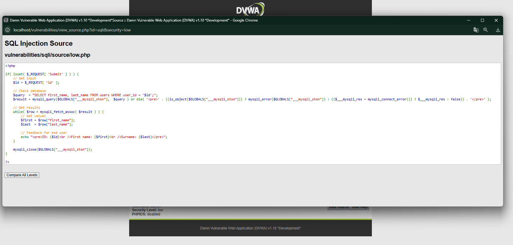

# Web Application Vulnerability Assessment: SQL Injection Analysis

**Author:** Timothy Wilson Marthen  
**Focus Area:** Application Security & Risk Management (GRC)  
**Target Environment:** Damn Vulnerable Web Application (DVWA - Local Lab)  
**Classification:** OWASP Top 10 (A03:2021 - Injection) | **Severity:** Critical (CVSS v3.1: 9.8)

---

## 1. Executive Summary
Pengujian keamanan (*Vulnerability Assessment*) dilakukan pada modul input pengguna di lingkungan simulasi aplikasi web (DVWA) untuk mengevaluasi ketahanan sistem terhadap serangan injeksi basis data. Hasil pengujian menemukan kerentanan **Critical SQL Injection** yang memungkinkan pihak tidak berwenang melewati mekanisme otorisasi dan mengekstrak seluruh kredensial pengguna (*username* dan *hash password*). Diperlukan remediasi segera pada lapisan kode *backend* menggunakan *Parameterized Queries* untuk mencegah pelanggaran kerahasiaan data dan kepatuhan regulasi.

## 2. Scope & Methodology
* **Target:** Modul SQL Injection pada DVWA (Security Level: Low).
* **Environment:** Docker Container (`vulnerables/web-dvwa`) pada Local Lab Environment.
* **Methodology:** Pengujian dilakukan secara manual (*black-box* dilanjutkan *white-box code review*) mengacu pada standar **OWASP Web Security Testing Guide (WSTG)**.

## 3. Technical Findings & Proof of Concept (PoC)

### Finding 01: Unsanitized User Input Leading to SQL Injection
* **CWE Reference:** CWE-89 (Improper Neutralization of Special Elements used in an SQL Command)
* **Deskripsi:** Parameter input `id` diproses langsung ke dalam *query* SQL tanpa validasi tipe data maupun pemisahan antara perintah SQL dan data input pengguna.

#### A. Perilaku Normal (Baseline)
Input valid (`1`) mengembalikan satu baris data pengguna sesuai rancangan sistem.


#### B. Eksploitasi Logic Bypass
Dengan menyuntikkan payload `' OR '1'='1`, struktur logika *query* dimanipulasi sehingga database mengembalikan seluruh baris data yang tersimpan.


#### C. Ekstraksi Kredensial (Database Enumeration)
Menggunakan operator `UNION SELECT`, penyerang dapat membaca tabel `users` dan mengekstrak kombinasi kredensial sensitif:

```sql
1' UNION SELECT user, password FROM users#
```


## 4. Root Cause & Risk Impact Analysis (GRC Perspective)

### Akar Masalah (Code Review)
Berdasarkan peninjauan *source code* pada *backend* PHP (`vulnerabilities/sqli/source/low.php`), variabel `$id` digabungkan secara langsung (*string concatenation*) ke dalam perintah SQL tanpa sanitasi:



### Dampak Bisnis & Kepatuhan (CIA Triad)
* **Confidentiality (High Impact):** Kebocoran seluruh data pribadi dan *password hash* pengguna. Dalam konteks operasional di Indonesia, insiden ini melanggar prinsip perlindungan data pada **UU No. 27 Tahun 2022 tentang Pelindungan Data Pribadi (UU PDP)** dan berpotensi menimbulkan sanksi administratif maupun kerugian reputasi.
* **Integrity (High Impact):** Penyerang berpotensi memodifikasi atau menghapus data transaksi apabila hak akses database tidak dibatasi.

## 5. Remediation & Security Controls

### Perbaikan Kode (Technical Fix)
Ganti mekanisme *string concatenation* dengan **PHP PDO Prepared Statements** agar input pengguna diperlakukan murni sebagai teks biasa, bukan perintah SQL:

```php
<?php
// Contoh Implementasi Aman Menggunakan PDO Prepared Statements
$stmt = $pdo->prepare('SELECT first_name, last_name FROM users WHERE user_id = :id');
$stmt->execute(['id' => $id]);
$user = $stmt->fetch();
?>
```

### Kontrol Pencegahan Tambahan (Defense-in-Depth)
1. **Input Validation (Allow-listing):** Terapkan validasi ketat di sisi *server* untuk memastikan parameter `id` hanya menerima karakter numerik (`is_numeric()`).
2. **Principle of Least Privilege (IAM):** Batasi hak akses akun database yang digunakan oleh aplikasi web agar hanya memiliki izin `SELECT`, `INSERT`, dan `UPDATE` pada tabel yang relevan (tidak menggunakan akun `root`).
3. **Strong Password Hashing:** Ganti algoritma *hashing* usang seperti MD5 dengan algoritma modern yang tahan terhadap *brute-force* seperti **Argon2id** atau **bcrypt**.