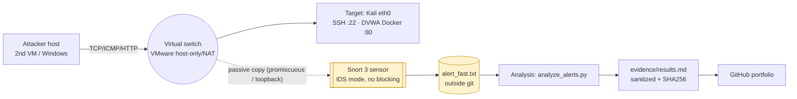

# 02 · Security Architecture & Threat Model

## 1. Lab architecture and sensor placement

> **As executed:** single-host loopback lab. Attacker scripts, HTTP/SSH target and the Snort sensor all run on one Kali VM and meet on `lo`. The diagram below shows the intended *production-style* placement; in the lab "Virtual switch" is the loopback interface. This removes NIC/SPAN effects (a stated limitation).

| Decision | Choice | Rationale (NIST SP 800-94 concepts) |
|---|---|---|
| Deployment mode | **Passive IDS** (alert only) | No availability risk to the protected service; appropriate while rules are still being tuned. IPS/inline only after FP rate is proven low. |
| Placement | In front of the protected segment (target NIC) | Sees north-south traffic to crown-jewel services. East-west traffic between hosts on the same switch needs a SPAN/tap. |
| Rule scope | `$HOME_NET` destinations | Alert only on attacks *against* protected assets – reduces noise from outbound traffic. |
| Log handling | Written outside the repo, redacted copy committed | Packet data = personal data (see 04). |

## 2. Assets and trust boundaries
| Asset | Value | Trust boundary |
|---|---|---|
| Protected services (SSH, DVWA) | Target of attack | Network ↔ host |
| Snort sensor + rule file | Integrity of detection | Management plane (admin only) |
| Alert logs / pcaps | Evidence + personal data | Sensor ↔ analyst storage |

## 3. STRIDE analysis of the **detection system itself**
A NIDS is a high-value target: if it is blinded or lied to, every downstream decision is wrong.

| Threat | Scenario | Existing control (lab) | Recommended control (production) |
|---|---|---|---|
| **S**poofing | Attacker spoofs source IP so `by_src` thresholds attribute to wrong host or never trigger | None (L3 only) | Ingress filtering (BCP 38), correlate with flow/auth logs |
| **T**ampering | Rule file or logs modified to hide activity | SHA256 manifest of evidence, rules versioned in Git | File-integrity monitoring on sensor, signed rule releases, WORM log storage |
| **R**epudiation | Analyst disputes an alert's origin/time | Timeline CSV + alert timestamps | NTP-synced sensors, centralized immutable logging |
| **I**nformation disclosure | pcap/alert files leak credentials, cookies, personal data | `.gitignore`, `06_sanitize_and_package.sh` secret scan | Encrypt at rest, access control, retention limit, data minimisation (snaplen/headers-only) |
| **D**enial of service | Traffic flood exceeds sensor capacity → silent packet loss (blind) | `event_filter` caps alert flood | Monitor drop counters, size capture hardware, load-balance sensors |
| **E**levation of privilege | Exploit in packet parser compromises the sensor (it runs as root, parses hostile input) | Passive mode, lab only | Run unprivileged after socket open, separate mgmt NIC, patch cadence (Snort 3 releases) |

## 4. Residual architecture gaps (honest list)
1. **Encrypted traffic** (TLS, SSH) hides payloads – quantified by SID 1000008, mitigated by TLS-terminating reverse proxy/WAF and host logs.
2. **Single sensor, single source of truth** – no correlation with host/auth logs (SIEM) → brute-force outcome unknown.
3. **No response automation** – detection only; containment is a human process ([07 runbook](07-alert-triage-runbook.md)).
