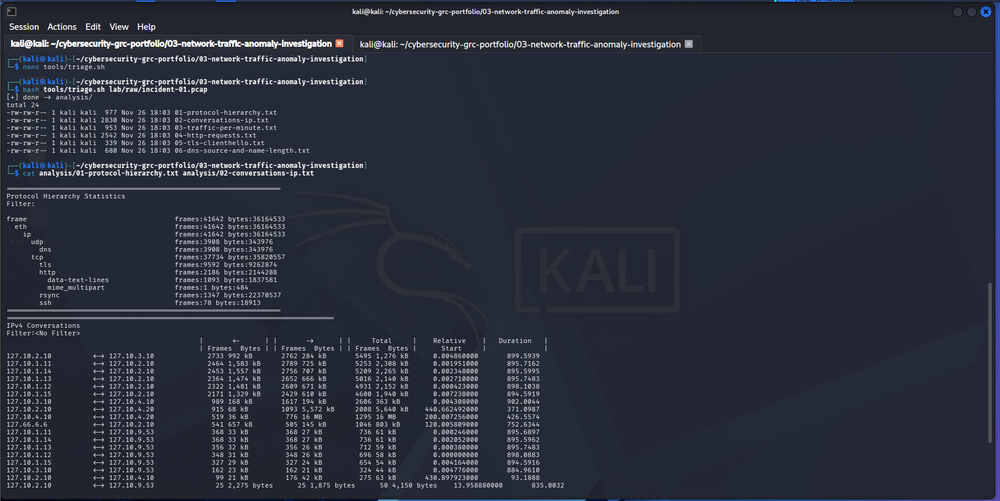
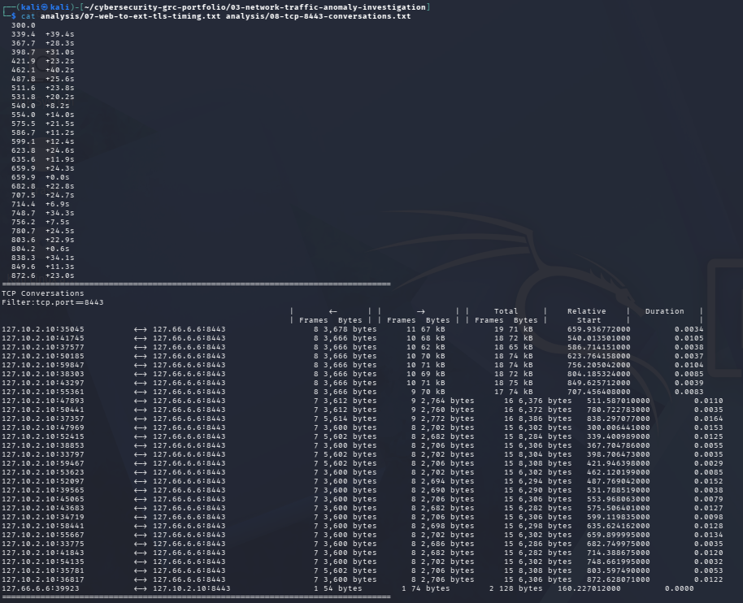
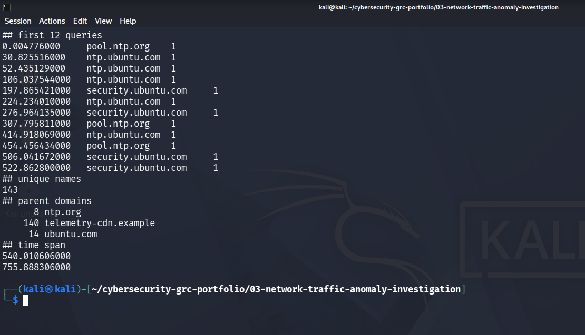

# 02 - Investigation Timeline

Capture: `incident-01.pcap`, 41,642 packets, 36,164,533 bytes, 902.0 s, 2026-11-26 17:38:19 to 17:53:21 (UTC+7).
SHA-256 `a981e31a6d1f416bf2f96ec3502023916741c8108eca09c3088288ac8a8713a4`. 0 packets dropped by the kernel. T+ is seconds from the first packet (17:38:19.65).
Raw capture is not published (payloads); derived outputs are in `analysis/`.

## Method
1. **Baseline** (`analysis/01-03`): protocol hierarchy, IPv4 conversations, per-minute volume.
2. **Hypotheses** from three lenses: who talks to whom, how much, and when.
3. **Verification** (`analysis/07-13`): timing statistics, per-session sizes, first-seen contacts, plaintext HTTP, DNS names.
4. **Classification**: malicious, benign, or unresolved, with the evidence for each.

## Baseline (what normal looks like)
- Five clients, each with 4,600-5,300 frames to the web server, 208-254 TLS sessions with SNI `shop.corp.example`, plain HTTP requests spread over three browser User-Agents (30-55 per client and User-Agent), and 650-740 DNS frames with query names of 7-25 characters.
- Web to app: 450 HTTP requests on port 8080 across the capture, about one every 2 s. Before T+300 s the web server initiates connections only to the app server (and DNS).
- Application server DNS: 22 queries, all NTP or Ubuntu update names (`pool.ntp.org`, `ntp.ubuntu.com`, `security.ubuntu.com`), roughly one every 40 s.
- Volume: 0.82-1.07 MB and 2,300-3,000 frames per minute.
- Protocol mix: TCP 37,734 frames (35.8 MB), of which rsync 22.4 MB (62% of bytes); DNS 3,908 frames; SSH 78 frames.

## Decoy ruled out: the backups
Three per-minute buckets stand out: 180-240 s (9.36 MB), 600-660 s (9.35 MB), 780-840 s (6.65 MB).
The first two are database-to-backup rsync transfers: internal pair, same direction, same size (~8 MB above background), long sessions, ~420 s apart.
They fit a scheduled job, but two occurrences are not proof; the authorising evidence in a real case would be the backup schedule or change record.
The 780-840 s bucket has a different shape (4,654 frames, about 2,150 above the baseline for 5.7 MB above background, against ~900 extra frames for each backup) and a different source. It is analysed below as stage 8.

## Timeline

| T+ (s) | Clock (UTC+7) | Source -> destination | Observation | Evidence | ATT&CK |
|---|---|---|---|---|---|
| 120.0-160.2 | 17:40:19 | 127.66.6.6 -> web | 18 single SYNs, one per port, ~2.4 s apart (21, 22, 23, 25, 53, 80, 110, 135, 139, 143, 443, 445, 1433, 3306, 3389, 5432, 8080, 8443) | `11` | T1595 |
| 163.6-188.4 | 17:41:03 | 127.66.6.6 -> web:80 | 30 GET requests for `/admin`, `/.git/config`, `/wp-login.php`, `/phpmyadmin`, `/backup`, ... repeated in random order | `10` | T1595.003 |
| 189.5-202.1 | 17:41:29 | 127.66.6.6 -> web:80 | 8 SQLi requests: `'`, `OR '1'='1`, `ORDER BY 3`, `uNiOn SeLeCt NULL,NULL`, `/**/` whitespace UNION, `UN/**/ION SEL/**/ECT`, `SLEEP(3)`, nested `SELECT SLEEP(2)` | `10` | T1190 |
| 203.8 | 17:41:43 | 127.66.6.6 -> web:80 | `POST /upload.php`, multipart body (1 multipart frame, 484 B) | `10`, protocol hierarchy | T1505.003 |
| 206.8-222.6 | 17:41:46 | 127.66.6.6 -> web:80 | 6 GETs to `/uploads/img.php?c=` with `id`, `whoami`, `uname -a`, `ip a`, `cat /etc/passwd`, `ls -la /var/www` | `10` | T1505.003 |
| 300.0-872.6 | 17:43:19 | web -> 127.66.6.6:8443 | 29 TLS sessions, SNI `cdn-assets.telemetry-cdn.example`. First outbound connection by the web server to any non-internal host. Splits into 21 check-ins and 8 uploads (below) | `05`, `07`, `08` | T1071.001, T1573 |
| 420.0-450.6 | 17:45:19 | web -> app, db, backup | 20 first-seen SYN probes: ports 22, 445, 3306, 5432, 6379, 873 (+8080) on the three hosts, 1-2 s apart; the probe to app:8080 is hidden in baseline traffic | `12` | T1046 |
| 434.2-503.9 | 17:45:33 | web -> db:3306 | 9 TCP sessions in 70 s; the web server never contacted the database before | `12`, `13` | T1110, T1078 (consistent with) |
| 451.9 | 17:45:51 | web -> app:22 | First SSH session from the web server to the app server | `12` | T1021.004 |
| 540.0-755.9 | 17:47:19 | app -> resolver | 140 unique DNS names of 79 characters under `telemetry-cdn.example`, mean spacing 1.55 s | `06`, `09` | T1048.003, T1071.004 |
| 540.0-849.6 | 17:47:19 | web -> 127.66.6.6:8443 | 8 TLS sessions of 62-71 kB upstream (~0.55 MB total), 36-49 s apart | `08` | T1041, T1030 |
| 780.0-804.4 | 17:51:19 | web -> backup:873 | 160 short sessions in 24 s (6.7 per second); 5.7 MB above background | `03`, `13` | T1486 (precursor) |
| 804.6 | 17:51:44 | web -> backup:22 | SSH session to the backup server right after the burst | `12` | T1021.004, T1490 |

## Key analytical results

**C2 channel (stage 5).** The 29 sessions are two behaviours interleaved.
- 21 check-ins: ~2.7 kB upstream per session (2,682-2,772 B) and 3.6 or 5.6 kB downstream. Start-to-start interval mean 28.6 s, standard deviation 6.4 s (CV 22%), range 20.2-40.2 s. A fixed ~30 s period with roughly ±35% jitter fits; 5 of the 21 responses carried ~2 kB more data than the rest (possible tasking; content encrypted).
- 8 uploads: 62-71 kB upstream, 36-49 s apart (see exfiltration).
- Reproduce: `python3 tools/beacon_stats.py lab/raw/incident-01.pcap 127.10.2.10 127.66.6.6 8443`.

**DNS tunnel (stage 9a).** 143 unique names from the app server: 3 legitimate (`pool.ntp.org`, `ntp.ubuntu.com`, `security.ubuntu.com`, 22 queries) and 140 under `telemetry-cdn.example`, every one unique, all 79 characters, between T+540.0 and T+755.9 s. Client names are 7-25 characters. Label length is consistent with 32 bytes per query (base32), i.e. at most ~4.5 KB carried; this is an inference, the labels were not decoded.

**Exfiltration volume.** About 0.55 MB over TLS plus at most ~4.5 KB over DNS. This is about 3% of the 16 MB the legitimate backups moved in the same capture, so a volume threshold would not flag it. Direction (internal to external) and the new destination are the discriminating signals.

**Mass writes to backup (stage 10).** The legitimate job is 2 long sessions from the database server. The anomalous traffic is 160 short sessions from the web server in 24 s, followed by an SSH session. Source, direction and session pattern all differ.

**HTTP response summary and visibility limits.** Across the capture, 1,093 HTTP responses were observed: 1,063 with status `200` and 30 with status `404` (matching the 30 directory enumeration probes in stage 2). TLS contents remain encrypted, and the database, SSH and rsync servers are stubs, so login success or failure and file-level actions are not observable.
